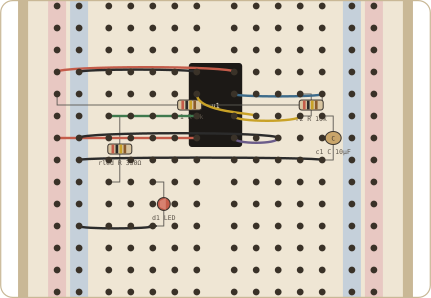
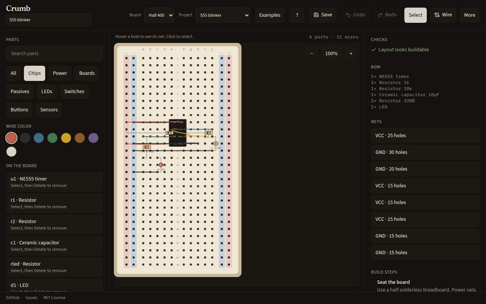
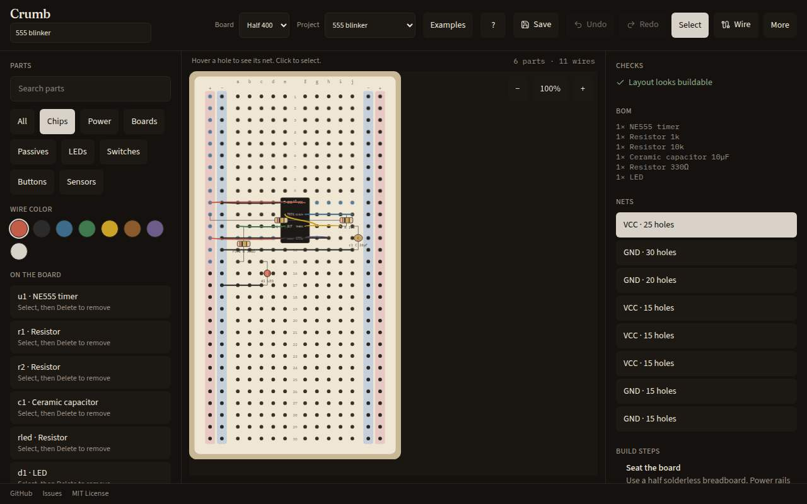
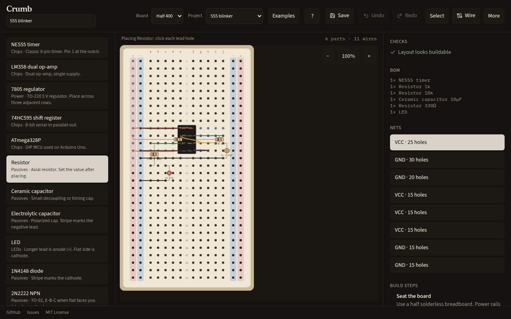
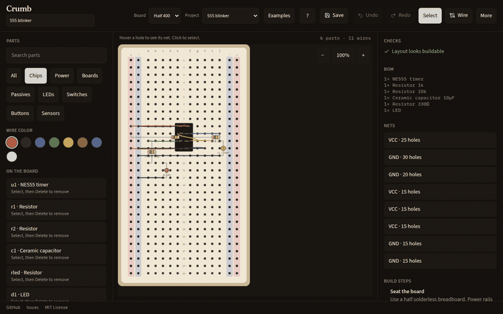

<p align="center">
  
</p>

<p align="center">
  <strong>Breadboard layouts a person can actually build.</strong><br />
  JSON in. A real solderless board out. An MCP server so an agent can place the parts.
</p>

<p align="center">
  <strong><a href="https://crumb.janglim.cloud">Try the demo</a></strong> — the editor, hosted at crumb.janglim.cloud.
</p>

<p align="center">
  
  
  
</p>

## How this was made

Crumb was vibe-coded: built mostly by prompting an AI and reviewing the output. Tests, CI, a dependency audit, and a security review are the safeguards around that work. Expect rough edges. If something is wrong or unclear, please [file an issue](https://github.com/anglim3/crumb/issues).

<p align="center">
  
</p>

<p align="center"><sub>The 555 blinker example, rendered by Crumb — same SVG the editor and CLI produce.</sub></p>

## Editor

<p align="center">
  
</p>

<p align="center">
  
</p>

<p align="center">
  
</p>

<p align="center">
  
</p>

<p align="center"><sub>Opening an example, highlighting a net, and placing a part.</sub></p>

---

Crumb is a **layout tool**, not a simulator. It draws the holes, strips, and jumpers you will use at the bench. It will yell if two parts share a hole or if VCC meets GND. It will not compute LED current.

## Features

- Interactive editor in the browser (zoom, drag, undo, net highlight, short glow)
- Hole addresses a human can follow (`10-e`, `LP-12`, `u1.VCC`, `m1.pos`)
- Catalog: DIP chips, Nano / Pico / ESP32 on the board, Uno / Pi off-board, passives, switches, sensors, power
- Short detection, build steps, BOM, JSON / SVG / PNG export, share links
- Local MCP server using the same validator as the editor
- SVG CLI with no `npm install`

## Limits and known gaps

- Layout only. Crumb checks shared holes and shorts. It does not simulate the circuit.
- The parts catalog is fixed. A part that is not listed stays off the board as a module.
- `nano` and `nano-esp32` are different boards. `nano-esp32` is the Arduino Nano ESP32 (ABX00083): pin 1 is D12 and sits in column f. `nano` is the classic Nano.
- There is no cloud sync and no live collaboration. A share link is a copy of the layout in the URL.
- The library is stored in this browser only.

## Quick start

**Editor**

```bash
git clone https://github.com/anglim3/crumb.git
cd crumb
npm install
npm run dev
```

Open [http://localhost:5173](http://localhost:5173). The dev server listens on localhost; set `CRUMB_DEV_HOST` if you need another interface. Pick an example, place parts, draw jumpers. Layouts autosave. A `#c=…` hash loads a shared project without replacing saved projects until you save. A short guide is on the site at [/how-it-works/](https://crumb.janglim.cloud/how-it-works/).

**CLI** — no install

```bash
node --experimental-strip-types scripts/crumb-svg.mjs examples/555-blinker.json blinker.svg
```

**Tests**

```bash
npm test
npm run lint
```

## Demo

The editor is live at **[crumb.janglim.cloud](https://crumb.janglim.cloud)**.

The hosted demo is the browser editor. The MCP server and SVG CLI stay on your machine.

Rebuild and deploy that site from this repo:

```bash
npm run deploy
```

[`wrangler.jsonc`](wrangler.jsonc) serves the Vite build (`./dist`) as a Workers static SPA (`not_found_handling: single-page-application`), so share links (`#c=…`) resolve to `index.html`. `/examples/` and `/how-it-works/` are extra HTML files in that build, so those addresses serve the pages. Any other unknown path still falls back to `index.html`. [`public/_headers`](public/_headers) is copied into that bundle and sets the response headers, including Content-Security-Policy. The custom domain is `crumb.janglim.cloud`. No Cloudflare account id is stored in the repo — authenticate with `wrangler login` or `CLOUDFLARE_API_TOKEN`. `npm run deploy:dry-run` checks the asset bundle without publishing.

## Examples

The same layouts are listed at [/examples/](https://crumb.janglim.cloud/examples/). Each link there opens that board in the editor.

| File | What it is |
| --- | --- |
| [`examples/555-blinker.json`](examples/555-blinker.json) | Astable 555 + LED |
| [`examples/button-led.json`](examples/button-led.json) | Button, resistor, and LED |
| [`examples/lm358-amplifier.json`](examples/lm358-amplifier.json) | LM358 non-inverting amplifier |
| [`examples/74hc595-leds.json`](examples/74hc595-leds.json) | 74HC595 with eight LEDs |
| [`examples/attiny85-blink.json`](examples/attiny85-blink.json) | ATtiny85 blink on PB0 |
| [`examples/esp32-led.json`](examples/esp32-led.json) | ESP32 DevKit and an LED |
| [`examples/pico-button.json`](examples/pico-button.json) | Pico with a button |
| [`examples/uno-dht22.json`](examples/uno-dht22.json) | Uno module and a DHT22 |
| [`examples/homekit-blinds.json`](examples/homekit-blinds.json) | Nano ESP32 + TMC2208 + NEMA 17 + limit switch |

The blinds bench jumpers the barrel jack (`m1.pos` / `m1.neg`) onto the lower RP / RM half (12 V; not jumped across the mid-board split) and the stepper coils onto the TMC2208 taps. LP is 3V3 from the Nano ESP32 and is jumped across the split so TMC VIO can share it. Use catalog id `nano-esp32`, not `nano`.

## MCP

Point the harness at this repo root as `cwd`. MCP does not need `npm install`.

```json
{
  "mcpServers": {
    "crumb": {
      "command": "node",
      "args": ["--experimental-strip-types", "mcp/server.mjs"],
      "cwd": "/absolute/path/to/crumb"
    }
  }
}
```

| Tool | What it does |
| --- | --- |
| `list_parts` | Search the catalog |
| `get_board` | Read the project JSON |
| `set_project` | Replace the whole document |
| `place_part` | DIP (`anchor`), leaded (`from` / `to` / `mid` / `legs`), module (`slot`, `offsetRow`) |
| `add_wire` | Jumper between holes or `part.pin` |
| `remove_part` | Drop a part by id |
| `list_nets` | List jumper endpoints |
| `validate` | Occupancy + rail / supply / lead shorts |

Read [AGENTS.md](AGENTS.md) before an agent starts placing parts. Default file: `examples/555-blinker.json`.

## Hole language

| Address | Meaning |
| --- | --- |
| `10-e` | Row 10, column e |
| `LP-10` / `LM-10` | Left + / − rail at row 10 |
| `RP-10` / `RM-10` | Right + / − rail |
| `u1.8` or `u1.VCC` | Pin on a placed part |
| `m1.5v` / `m1.pos` | Pin on any off-board module |

Boards: `mini` (17 rows), `half` (30, split rails), `full` (63, split rails).

`a`–`e` on a row are one strip. `f`–`j` are another. The gutter isolates them. Split rails break at mid-board — jumper the two halves if you need them joined.

DIP pin 1 sits on the left strip (`a`–`e`). The body crosses the gutter.

- `esp32` is a **30-pin** DevKit, pin 1 = 3V3. Park a 38-pin DevKitC as a module.
- `nano-esp32` is ABX00083. Pin 1 is D12 at the USB end — seat pin 1 in column f. Digital silk is D12…D2, GND, RESET, D0/RX0, D1/TX0 on the f strip; analog is D13, 3V3, B0… on the e strip.
- Leaded parts: two holes (`from` / `to`), three (`mid`), or four (`legs`).

<details>
<summary>Project file shape</summary>

```json
{
  "version": 1,
  "name": "555 blinker",
  "board": "half",
  "parts": [
    { "kind": "dip", "id": "u1", "def": "ne555", "anchor": "10-e" },
    { "kind": "leaded", "id": "r1", "def": "resistor", "from": "LP-11", "to": "11-j", "value": "1k" }
  ],
  "wires": [{ "id": "w1", "from": "u1.8", "to": "LP-10", "color": "#c45c4a" }]
}
```

Catalog ids live in [`src/lib/crumb/catalog.ts`](src/lib/crumb/catalog.ts). Keep [`mcp/catalog.json`](mcp/catalog.json) in sync when you add parts.

</details>

## Catalog sources

The part catalog is hand-maintained in [`src/lib/crumb/catalog.ts`](src/lib/crumb/catalog.ts). [`mcp/catalog.json`](mcp/catalog.json) is a copy for the MCP server — regenerate it when the catalog changes. Pin names are labels for the drawn package, taken from common datasheets. They are not an electrical model. Check the datasheet before you build. Do not use `nano` for a Nano ESP32.

## Repo map

| Path | What |
| --- | --- |
| `src/lib/crumb/` | Model, nets, shorts, SVG |
| `src/components/crumb/` | Editor |
| `src/main.tsx` | Vite entry |
| `mcp/server.mjs` | MCP adapter |
| `scripts/crumb-svg.mjs` | CLI render |
| `examples/` | Known-good boards, and the crawlable gallery page |
| `how-it-works/index.html` | Crawlable guide |

## Contributing

Contributions are welcome. Read [CONTRIBUTING.md](CONTRIBUTING.md) for setup, checks, and how changes should land. Placement notes live in [AGENTS.md](AGENTS.md). Security reports go through [SECURITY.md](SECURITY.md).

## License

[MIT](LICENSE). Not SPICE. Not a PCB tool.
